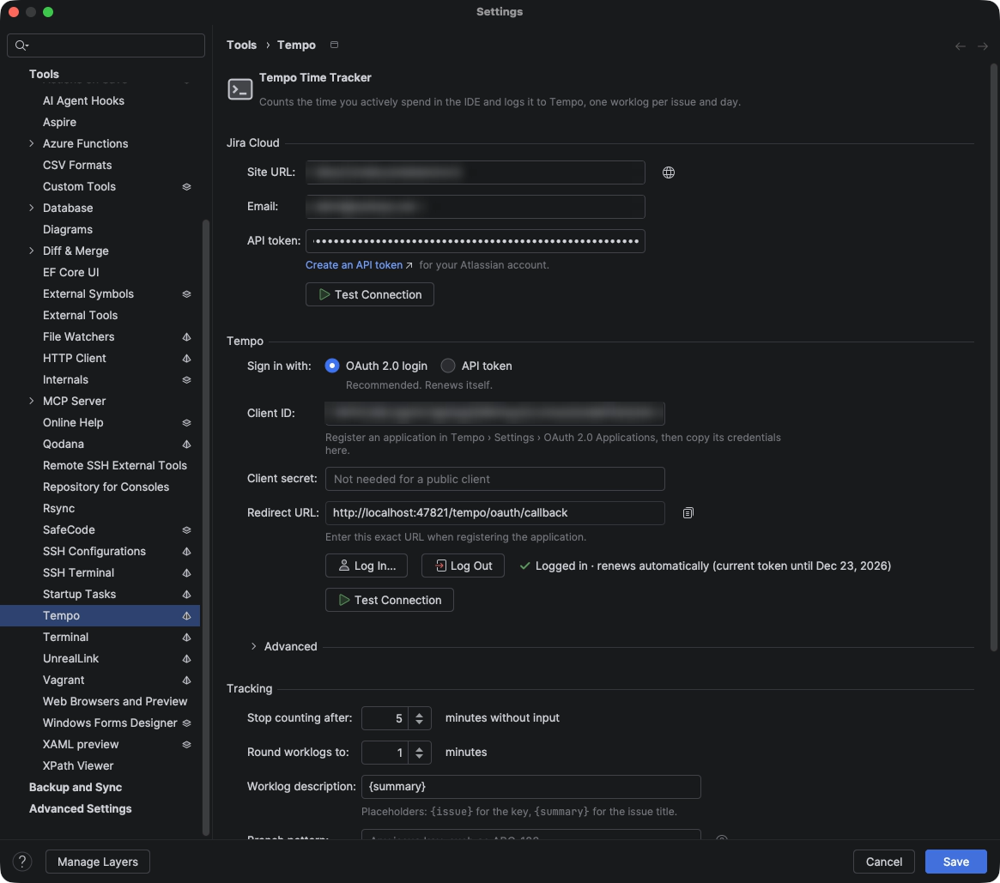

# ⏱️ IDE Connector for Tempo

Tracks the time you actively spend in Rider (or any JetBrains IDE) and logs it to
[Tempo](https://www.tempo.io/) on Jira Cloud. Work on a branch named after a Jira issue, and the
time lands on that issue in Tempo, without timers to start or stop.



## Features

- **Counts active time only.** Time accrues while you type, click or navigate in a project's
  window. After a configurable stretch without input (default 5 minutes) the session ends at your
  last activity, so idle time is never logged.
- **Knows which issue you are on.** In order of precedence:
  1. an issue set manually (*Tools › Tempo › Set Issue…* or the status bar widget),
  2. the Jira key in the current Git branch (`features/ABC-123-new-login` → `ABC-123`), found
     with a [branch pattern](#branch-pattern) you can customize,
  3. the project's default issue (*Settings › Tools › Tempo*).
- **Shows it in the status bar**, with the time not sent yet:

  | Current branch | Status bar |
  | --- | --- |
  |  |  |

- **One worklog per issue and day.** Later submissions update that worklog in Tempo instead of
  adding new ones.
- **Automatic or on-demand submission.** Sends every 5 minutes by default, at any interval you
  choose, or only when you run *Tools › Tempo › Submit Worklogs*.
- **Logs in to Tempo with OAuth 2.0.** No token to copy or renew by hand; an API token still works.
- **Nothing gets lost.** Unsent time is saved and survives IDE restarts.

## Setup

Install the plugin, then open *Settings › Tools › Tempo*.

### 1. Jira Cloud

Enter your site URL (`https://your-domain.atlassian.net`), your Atlassian email and an
[API token](https://id.atlassian.com/manage-profile/security/api-tokens). The plugin uses them to
look up issue ids and your account id. Click **Test Connection** to check them.

### 2. Tempo

Choose how to sign in.

**OAuth 2.0 login (recommended).** Someone with Tempo administrator rights registers the plugin
once for your Jira site:

1. In Tempo, open *Settings › Data Access › OAuth 2.0 Applications › New Application*.
2. Fill in:

   | Field | Value |
   | --- | --- |
   | Name | anything, e.g. `JetBrains IDE` |
   | Redirect URL | `http://localhost:47821/tempo/oauth/callback` |
   | Client type | Public (no client secret needed) |
   | Authorization grant type | Authorization code |

3. Copy the **Client ID** from *Actions › Credentials*.

Then, in the IDE, paste the client ID, leave the client secret empty for a public client, and
click **Log In…**. Your browser opens Tempo's consent page; once you allow access, the page shows
*Logged in*. The plugin renews the token automatically before it expires.

The IDE listens on port 47821 only while you log in, and only on your own machine.

**API token.** Create one in Tempo (*Settings › API integration › New token*) and paste it in.
Tempo API tokens expire, so you replace it by hand when it does.

### 3. Tracking and submission

Adjust the idle timeout, rounding, worklog description and submission mode if the defaults do not
suit you, and optionally set a default issue for the project.

Tokens and the client secret are stored in the IDE password safe (by default, the system
keychain), never in settings files.

## Branch pattern

By default, the plugin finds any issue key in the branch name, such as `ABC-123`. To be stricter,
set *Branch pattern* to a regular expression. The key is taken from the group named `key`, else
from group 1, else from the whole match:

| Branch | Pattern | Issue |
| --- | --- | --- |
| `features/ABC-123-new-login` | *(empty)* | `ABC-123` |
| `team/web/PAY-42-checkout` | `^\w+/\w+/(?<key>[A-Z]+-\d+)` | `PAY-42` |
| `dev/abc-9_fix` | `(?i)^dev/(\w+-\d+)` | `ABC-9` |

Matching is case-sensitive unless the pattern starts with `(?i)`. Keys are uppercased.

## How time becomes worklogs

- Tracked sessions are grouped by issue and day. The worklog starts at the day's first session
  on that issue.
- Totals are rounded to the nearest increment (default 5 minutes). Today's time that still rounds
  to zero stays pending; past days round up to one increment.
- If a worklog the plugin created is deleted in Tempo, the next submission creates a new one with
  only the time still pending. If you edit one in Tempo, the next submission on that issue that
  day overwrites the duration with the tracked total.

## Troubleshooting

- **No issue in the status bar:** hover over the widget to see where the issue comes from. Check
  the branch pattern, and that the Git plugin is enabled.
- **Submission errors** appear as notifications and in `idea.log` (*Help › Show Log in Finder*),
  as `Tempo submission failed`.
- **Port 47821 is in use:** close the program using it, then log in again.

## Development

```bash
./gradlew test          # unit tests
./gradlew runIde        # sandbox IDE with the plugin
./gradlew buildPlugin   # zip in build/distributions
```
